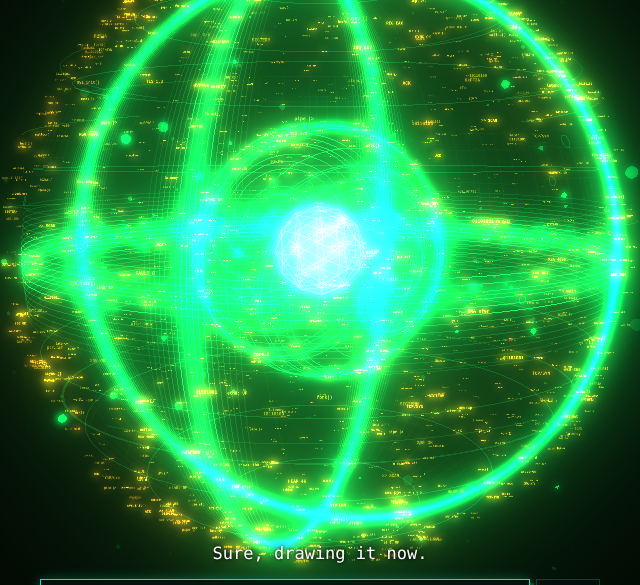
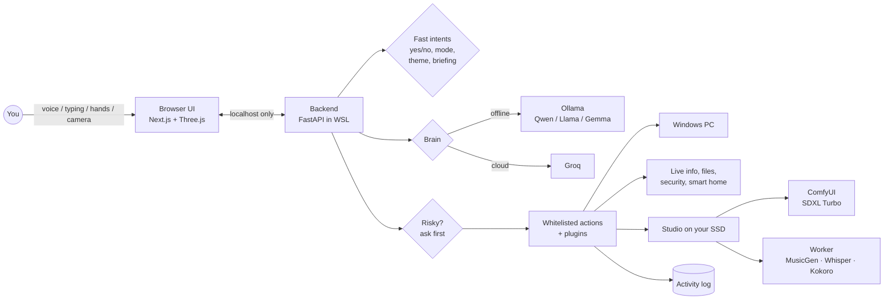

<div align="center">

```
 ███╗   ██╗███████╗███╗   ███╗██╗██╗██╗
 ████╗  ██║██╔════╝████╗ ████║██║██║██║
 ██╔██╗ ██║█████╗  ██╔████╔██║██║██║██║
 ██║╚██╗██║██╔══╝  ██║╚██╔╝██║██║██║██║
 ██║ ╚████║███████╗██║ ╚═╝ ██║██║██║██║
 ╚═╝  ╚═══╝╚══════╝╚═╝     ╚═╝╚═╝╚═╝╚═╝
```

### `// VOICE-FIRST AI OPERATOR  ·  RUNS YOUR PC  ·  MAKES THINGS OFFLINE  ·  LIVES ON A HOLOGRAPHIC ORB`

*Say it. She does it. Then she tells you what really happened.*




</div>

---

## `> SYSTEM BRIEFING`

NEMIII is a personal AI that lives on your Windows PC and actually operates it. Talk to her, type to her, wave at her camera, or tell her to look at your screen. She opens apps and games, plays music, sets reminders, reads your mail, reports the news, guards your network, and now **draws pictures, composes music, speaks in a natural voice and transcribes recordings, all offline from your own SSD**.

Her face is an orb of glowing lines, code text and debris. It pulses with your real voice, reacts when she thinks and speaks, and comes in four colour themes. Say *"come here"* and your own video takes over the screen instead.

> **Built for a laptop, not a data centre.** Everything is sized for an RTX 4050 (6 GB) and a small internal drive. Heavy things live on an external SSD.

## `> CORE PRINCIPLES`

| | |
|---|---|
| **HONEST BY DESIGN** | She reports success only when the action really worked. If it failed, she says so. |
| **FIXED ACTION LIST** | The AI picks from a whitelist. It can never run free-form commands on your PC. |
| **ASKS BEFORE RISKY THINGS** | Closing programs, locking, typing for you, power, downloading or deleting models: she asks, you say yes or tap YES. |
| **LOCAL OR CLOUD BRAIN** | Fully offline with Ollama, cloud with Groq, or `auto` (local first, cloud as backup). |
| **EVERYTHING IS LOGGED** | The ACTIVITY tab shows every action she ran and whether it worked. |
| **LIGHT ON YOUR GPU** | The orb is a handful of draw calls and lowers its own quality if the PC struggles. |

---

## `> SUBSYSTEMS`

### 01 · PC CONTROL
Open or close any app or game, folders, web search, YouTube, media keys, volume, brightness, screenshots, lock, minimise or restore windows, switch tabs, copy and paste, type into an app, WhatsApp message (you press send), VS Code projects, GitHub repos. Sleep, restart and shutdown give you a 30 second cancel window.

### 02 · LIVE INTEL
News, weather, time, Wikipedia, currency and an exact calculator, your GitHub activity, project git status, unread Gmail (read-only), PC vitals (CPU, memory, disk, battery) and the biggest memory users. Facts come from the real source, never from guesses.

### 03 · DAILY OPS
Reminders, timers and alarms (also every day), a spoken morning briefing (*"good morning"*), memory (*"remember that my exam is on Friday"*), find, read and open your files (txt, md, code, docx, pdf), clipboard.

### 04 · THE STUDIO (offline, on your SSD)
| Command | Result |
|---|---|
| *"Draw a neon city at night"* | A picture from SDXL Turbo through ComfyUI, with a live progress bar |
| *"Make fifteen seconds of calm lo-fi piano"* | A music clip from MusicGen |
| *"Say good morning team as an audio file"* | A spoken file from the Kokoro voice |
| *"Transcribe my lecture recording"* | Offline Whisper transcript |
| *"Install the image model"* / *"Delete the music model"* | Download or free space, always asks first |
| *"Show my creations"* | A viewer opens over the orb: pictures, audio player, transcripts |

One creation at a time (6 GB cannot do two). Everything lands on the SSD. See [docs/STUDIO.md](docs/STUDIO.md).

### 05 · SECURITY HELPERS (your own machine and home network only)
Which ports are open, is this link safe, which devices are on my network, the newest actively exploited vulnerabilities (CISA list), what is my honeypot doing. Scans refuse anything that is not this computer or a private address.

### 06 · SMART HOME
Lights, switches, fans and scenes through Home Assistant. Never locks, doors or alarms.

### 07 · SENSES AND HANDS
*"What do you see?"* uses the camera, *"look at my screen"* explains a window. Hand gestures: double pinch greets you, swipe switches tab, fist minimises everything, two fingers copy, three fingers paste.

### 08 · VOICE
A natural offline voice (Kokoro) with an automatic fallback to the browser voice. Each mode has its own voice and speed. She never reads symbols, links or file paths aloud, and says "for example" instead of "e g". **PAUSE** and **STOP** buttons (`K`, Space) for long answers.

---

## `> PERSONALITY MODES`

Say **"switch to Jarvis"**, or just call her by name: *"Friday, what's the weather?"*

| Mode | Style |
|---|---|
| **NEMIII** | Calm, warm, attentive. The default. |
| **JARVIS** | Formal, courteous, protective, a touch of dry understatement. |
| **FRIDAY** | Tactical and direct. Leads with the result. |
| **EDITH** | Strictly literal and neutral. "Done." "Unable: reason." No chatter. |

Only the **tone** changes. In every mode she can use only her fixed action list, and risky actions always ask first.

---

## `> ARCHITECTURE`



1. Your browser hears you (or you type) and sends the text to the backend.
2. Simple commands (yes, no, mode, theme, briefing) are answered instantly without the AI.
3. Otherwise the brain turns it into a reply plus up to six actions from the whitelist.
4. Risky actions wait for your yes. The rest run through PowerShell on the Windows side, fetch live facts, or start a studio job.
5. The real result comes back, is written to the activity log, and she says it out loud.

---

## `> BOOT SEQUENCE (INSTALL)`

You need Windows 10 or 11 with WSL2, Python 3.10+, Node 20+ and Chrome or Edge.

```bash
git clone https://github.com/neminorniel24-droid/nemin-s-FRIDAY.git
cd nemin-s-FRIDAY
bash scripts/install.sh --shortcut      # sets everything up and puts a NEMIII icon on your desktop
./run.sh --open                          # launch
./stop.sh                                # shut down
```

The installer finds your older keys (`backend/.env`), Gmail login and video, builds everything, runs the tests, and adds the desktop icon. Fresh install? Put your free-tier keys in `backend/.env`: `GROQ_API_KEY`, `NEWSDATA_KEY`, `YOUTUBE_API_KEY`.

```bash
bash scripts/windows-shortcut.sh --tray --autostart   # tray icon + start with Windows
bash scripts/install-local-model.sh                   # fully offline brain (Ollama)
```

### Studio on an external SSD (optional)

```bash
ls /mnt                                                          # find your drive, e.g. /mnt/d
bash scripts/studio-setup.sh /mnt/d/NemiiiStudio --tools --comfy --ollama
./run.sh --open
bash scripts/studio-start.sh                                     # picture engine, when you want pictures
```
Then just say: *"Studio status"*, *"Install Whisper"*, *"Install the image model"*. Nothing is downloaded until you do this.

### What fits a 6 GB card

| Job | Model | Size | Status |
|---|---|---|---|
| Chat brain | Llama 3.2 3B, Qwen 2.5 7B | 2 / 4.7 GB | automatic |
| Vision | Moondream, Gemma 3 4B | 1.7 / 3.3 GB | automatic |
| Speech to text | Whisper small | 0.5 GB | automatic |
| Voice | Kokoro 82M | 0.34 GB | automatic |
| Pictures | SDXL Turbo (ComfyUI) | 6.9 GB | automatic |
| Music | MusicGen small | 2.4 GB | automatic |
| Video | Wan 2.1 1.3B, LTX-Video | 9-10 GB | manual, slow |
| 3D | TripoSR | 1.5 GB | manual |

Honest limits: video and 3D are possible on 6 GB only as short, slow, low-resolution runs, so they are not automated. SDXL Turbo and MusicGen weights have non-commercial terms.

---

## `> COMMAND REFERENCE`

| Say | What happens |
|---|---|
| "Nemiii, open Steam" | Wake word, then any request. She keeps listening for 45 seconds, so you do not repeat her name. |
| "Switch to Jarvis" / "Edith mode" | Changes personality and voice. |
| "Good morning" | Spoken briefing: date, weather, mail, headlines, GitHub, reminders. |
| "Remind me in 20 minutes to stretch" / "Alarm at 6:30" | Reminders, timers, alarms. |
| "Close Chrome" | She asks first. Say yes or no, or tap the buttons. |
| "Find my resume pdf" / "Summarise my notes file" | Searches and reads Documents, Downloads, Desktop. |
| "Is this link safe? bit.ly/..." / "Scan my Windows ports" | Security helpers. |
| "Draw ..." / "Make music ..." / "Transcribe ..." | Studio. |
| "Show my creations" | Viewer over the orb. |
| "Red alert" / "Theme gold" | Colours: `peacock`, `red`, `gold`, `ice`. |
| "Mini orb" / "Show history" | Floating orb, side panel. |
| "Come here" / "Back to orb" | Video mode and back. |
| "Stop" or Space | She stops talking. |

**Keys:** `V` talk once · `W` wake word · `G` hands · `M` orb/video · `C` camera · `S` screen · `T` theme · `P` panel · `N` mini orb · `F` creations · `K` pause or resume · `Space` stop · `R` `+` `-` orb view.

---

## `> PLUGINS`

Drop a `.py` file into `backend/plugins/` and restart. See [backend/plugins/README.md](backend/plugins/README.md) and the example `dice.py`. A broken plugin never stops the others, and everything a plugin does is logged.

## `> MAKE IT YOURS`

- **Personalities:** `backend/personas.py` · **Colours:** `lib/themes.ts`
- **Your video:** `public/nemiii-video.mp4`, or `bash scripts/prepare-video.sh "/path/to/video.mp4"` (never stretched)
- **Orb sharpness vs speed:** `MAX_PIXEL_RATIO` at the top of `lib/orbScene.ts`
- **Settings** in `backend/.env`: `ADDRESS_AS`, `HOME_ASSISTANT_URL`, `HOME_ASSISTANT_TOKEN`, `HONEYPOT_CONTAINER`, `FILES_ROOTS`, `TIMEZONE`, `PROJECT_PATHS`, `MODELS_ROOT`, `TTS_VOICE`, `LOCAL_MODEL`

## `> DIAGNOSTICS`

```bash
bash scripts/doctor.sh      # prints what works and what does not
```

- **Bus error while installing:** low memory. Close Chrome tabs and Docker, then `bash scripts/install.sh --clean`.
- **Port 3000 taken:** `./run.sh` automatically uses 3001, 3002 or 3003.
- **Microphone blocked:** click the lock icon in the address bar and allow it. You can always type.
- **Reminder time wrong:** WSL may run in UTC. She uses your browser's timezone; to force one set `TIMEZONE=Asia/Kolkata`.
- **Gmail asks to sign in again:** `cd backend && .venv/bin/python gmail_auth.py`.
- **"I can't see the studio folder":** the SSD is unplugged or changed letter. Re-run the setup with the new path.
- **"ComfyUI isn't running":** `bash scripts/studio-start.sh`, wait a minute, log is `logs/comfyui.log`.
- **"Friday" wakes her by accident:** it is also a day of the week. Remove it from `WAKE_NAMES` in `lib/modes.ts`.

---

## `> SAFETY PROTOCOLS`

- The backend listens on `127.0.0.1` only, so it is never exposed to your network.
- Actions are a fixed whitelist. Risky ones need your yes. Scans and link checks touch only your own machine and private addresses.
- She never reads files that look like secrets and never opens programs or scripts.
- Studio installs only from a built-in catalog (a model can never supply a URL or command), refuse to fill the drive, and never delete outside the studio folder. Files are served only from four output folders.
- `backend/.env`, `credentials.json`, `token.json` and `backend/data/` are git-ignored. **Never commit them.** Rotate any key you ever pasted into a chat or screenshot.
- Gmail access is read-only.
- **OpenClaw** (an autonomous agent) is deliberately not wired in. It has full computer access and belongs in an isolated place. See [docs/OPENCLAW.md](docs/OPENCLAW.md).

## `> STATUS`

| Area | State |
|---|---|
| Backend (actions, router, reminders, studio, voice) | Covered by automated tests, run in CI |
| Orb, panel, progress bar, viewer, pause and stop | Checked in a real browser |
| Windows-only features (tray, shortcut, power, toasts, clipboard, PC vitals) | Written for Windows, depends on your machine |
| Real image, music and voice generation | Needs the studio installed on your hardware |

## `> ROADMAP`

- [x] Orb with live reactions, mic-reactive, four themes
- [x] Local and cloud brain with automatic fallback
- [x] Camera and screen vision, hand gestures, wake word
- [x] Personalities, confirmations, reminders, briefing, files, security helpers, smart home
- [x] Plugins, activity log, tray icon, mini orb, CI
- [x] Studio: pictures, music, voice, transcription, on an external SSD
- [x] Natural voice, pause and stop, progress bar, creations viewer
- [ ] Video and 3D automation
- [ ] Calendar sync
- [ ] Per-app skills (Spotify, VS Code, browser tabs)
- [ ] Phone notifications for reminders

## `> CREDITS`

**Nemin Orniel D**, B.Tech CSE (Cyber Security), Karunya Institute of Technology and Sciences.

Built on [FastAPI](https://fastapi.tiangolo.com), [Next.js](https://nextjs.org), [Three.js](https://threejs.org), [MediaPipe](https://developers.google.com/mediapipe), [Ollama](https://ollama.com), [Groq](https://groq.com), [ComfyUI](https://github.com/comfyanonymous/ComfyUI), [faster-whisper](https://github.com/SYSTRAN/faster-whisper), [kokoro-onnx](https://github.com/thewh1teagle/kokoro-onnx), and the open models they run.

*Personality modes are original tone styles inspired by the fictional assistants of the Iron Man films. This project is a personal fan-inspired tool and is not affiliated with, or endorsed by, Marvel or Disney.*

MIT licensed. Pull requests and ideas are welcome: see [CONTRIBUTING.md](CONTRIBUTING.md).
