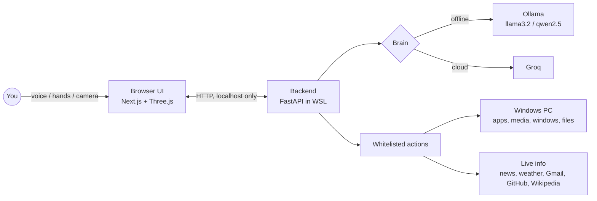

<div align="center">

# N · E · M · I · I · I

### A voice-first AI operator for your Windows PC. Built in WSL. Runs on a holographic orb.

*Say a thing. She does the thing. Then she tells you what happened.*


</div>

---

## What it is

NEMIII is a personal assistant that lives on your desktop and actually operates your machine. Talk to her, wave at her camera, or ask her to look at your screen. She opens apps and games, plays music, reads your mail, reports the news, checks your GitHub and remembers what you tell her.

She has two faces:

- **The orb**: thousands of glowing lines, code text and debris around a pulsing core. It reacts live while she listens, thinks and speaks.
- **Video mode**: say *"come here"* and a video of your choice takes over the screen and she talks to you. Say *"back to orb"* to return.

## Why it is different

| | |
|---|---|
| **Honest by design** | She only reports success when the action really worked. If it failed, she says so. |
| **Whitelisted actions** | The AI picks from a fixed list of 32 safe actions. It can never run free-form shell commands on your PC. |
| **Local or cloud brain** | Run fully offline with a local model (Ollama), use Groq in the cloud, or let `auto` choose. |
| **Sees things** | Camera and screen vision: *"what do you see?"*, *"look at my screen"*. |
| **Hands-free** | Wake word, plus camera hand gestures (double pinch, swipe, fist, two and three fingers). |
| **Light on the GPU** | The orb draws in about 45 calls, and it lowers its own quality if your PC struggles. |

## How it works



1. Your browser hears you (Web Speech) and sends the text to the backend.
2. The brain turns it into a reply plus up to three actions from the whitelist.
3. The backend runs them through PowerShell on the Windows side, or fetches live facts.
4. The real result comes back and she says it out loud.

## What she can do

**PC control**: open or close any app or game, open folders, search the web, play a song on YouTube, media keys, volume, brightness, screenshot, lock, minimise or restore all windows, switch tabs, copy and paste, type into an app, send a WhatsApp message, open a project in VS Code, open a GitHub repo.

**Live facts (read aloud from the real source)**: world news, weather, time, Wikipedia, currency, an exact calculator, your GitHub activity, git status of your projects, unread Gmail.

**Memory**: *"remember that my exam is on Friday"*, *"forget that"*.

**Senses**: *"what do you see?"* uses the camera, *"look at my screen"* explains a window.

**Hands**: double pinch greets you, swipe switches tab, fist minimises everything, two fingers copy, three fingers paste.

## Quick start

You need Windows 10/11 with WSL2, Python 3.10+, Node 20+ and Chrome or Edge.

```bash
git clone https://github.com/neminorniel24-droid/nemin-s-FRIDAY.git
cd nemin-s-FRIDAY
bash scripts/install.sh --shortcut      # sets up everything and adds a desktop icon
./run.sh --open                          # start
./stop.sh                                # stop
```

Add your keys in `backend/.env` (free tiers work): `GROQ_API_KEY`, `NEWSDATA_KEY`, `YOUTUBE_API_KEY`.

For a fully offline brain:

```bash
bash scripts/install-local-model.sh
```

Something wrong? `bash scripts/doctor.sh` prints what works and what does not.

## Controls

| Key | Action | | Key | Action |
|---|---|---|---|---|
| `V` | Talk once | | `C` | Camera look |
| `W` | Wake word on/off | | `S` | Screen look |
| `G` | Hand gestures | | `Space` | Stop talking |
| `M` | Orb / video | | `R` `+` `-` | Orb view: reset, zoom |

## Make it yours

- **Her voice and manner**: `backend/persona.py`
- **Colours**: the top of `app/globals.css` and `lib/orbScene.ts`
- **Your video**: put an H.264 file at `public/nemiii-video.mp4` or run `bash scripts/prepare-video.sh "/path/to/video.mp4"`
- **Quality vs speed of the orb**: `MAX_PIXEL_RATIO` in `lib/orbScene.ts`
- **New actions**: add a function with `@action(...)` in `backend/actions/`

## Safety

- The backend listens on `127.0.0.1` only, so it is never exposed to your network.
- Actions are a fixed whitelist. Nothing runs that is not on the list.
- `backend/.env`, `credentials.json` and `token.json` are git-ignored. Never commit them.
- Gmail access is read-only.

## Roadmap

- [x] Orb UI with live state reactions
- [x] Local and cloud brain with automatic fallback
- [x] Camera and screen vision
- [x] Hand gestures and wake word
- [x] One-click install and desktop icon
- [ ] Windows system-tray launcher
- [ ] Per-app skills (Spotify, VS Code, browser tabs)
- [ ] Calendar and reminders
- [ ] Plugin system for custom actions
- [ ] Optional text chat panel

## Built by

**Nemin Orniel D**, B.Tech CSE (Cyber Security), Karunya Institute of Technology and Sciences.

MIT licensed. Pull requests and ideas welcome.
