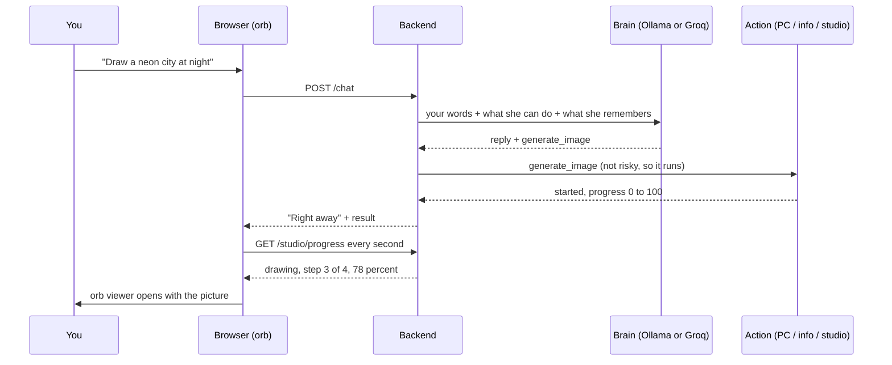

<p align="center">
  
</p>

<p align="center">
  <b>Your own J.A.R.V.I.S.-style assistant. Built in WSL, lives on a holographic orb.</b><br>
  Talk to her, type to her, wave at her camera. She runs your PC, draws pictures, composes music,<br>
  speaks in a natural voice and transcribes recordings, <b>offline, from your own SSD</b>.
</p>

<p align="center">
  
  
  
  
  
  
  
</p>

<p align="center">
  <a href="#-what-it-is">What it is</a> ·
  <a href="#-install">Install</a> ·
  <a href="#-the-studio">Studio</a> ·
  <a href="#-personalities">Personalities</a> ·
  <a href="#-talking-to-her">Commands</a> ·
  <a href="#-safety">Safety</a> ·
  <a href="#-troubleshooting">Troubleshooting</a> ·
  <a href="#-roadmap">Roadmap</a>
</p>

---

## 📑 Contents

1. [What it is](#-what-it-is)
2. [What she can and can't do](#-what-she-can-and-cant-do)
3. [How it works](#-how-it-works)
4. [Subsystems](#-subsystems)
5. [The screen](#-the-screen)
6. [Install](#-install)
7. [The Studio (offline models on your SSD)](#-the-studio)
8. [Personalities](#-personalities)
9. [Talking to her](#-talking-to-her)
10. [Plugins](#-plugins)
11. [Safety](#-safety)
12. [Configuration](#-configuration)
13. [API reference](#-api-reference)
14. [Files in this repo](#-files-in-this-repo)
15. [Troubleshooting](#-troubleshooting)
16. [Roadmap](#-roadmap)
17. [Credits](#-credits)

---

## 🧠 What it is

NEMIII is a personal AI that lives on your Windows PC and **actually operates it**.

- 🎙️ **Talk, type, wave.** Wake word, push to talk, a text chat bar, camera hand gestures.
- 🖥️ **She controls your PC.** Apps, games, media, windows, files, reminders, mail, news, GitHub.
- 🎨 **She makes things, offline.** Pictures, music, voice recordings, transcripts, stored on your external SSD.
- 🔮 **She has a face.** An orb of glowing lines, code text and debris that pulses with your real voice. Say *"come here"* and your own video takes over instead.
- 🛡️ **She stays honest and safe.** She can only use a fixed list of actions, asks before anything risky, and reports success only when it really worked.

> **Built for a laptop, not a data centre.** Everything is sized for an RTX 4050 (6 GB) and a small internal drive. The heavy parts live on an external SSD.

<table align="center">
<tr>
<td align="center"><b>67</b><br><sub>whitelisted actions</sub></td>
<td align="center"><b>4</b><br><sub>personality modes</sub></td>
<td align="center"><b>7</b><br><sub>risky actions that always ask</sub></td>
<td align="center"><b>4</b><br><sub>colour themes</sub></td>
<td align="center"><b>110+</b><br><sub>automated tests</sub></td>
</tr>
</table>

---

## ⚖️ What she can and can't do

**Honest version first.**

| ✅ Works well | ⚠️ Limits |
|---|---|
| Voice and text control of your Windows PC from WSL | Windows features need a real Windows machine (tray, toasts, power, clipboard) |
| Live facts: news, weather, Wikipedia, currency, GitHub, Gmail | News and weather need free API keys |
| Pictures (SDXL Turbo) and music (MusicGen) on a 6 GB card | One creation at a time. A 6 GB card cannot do two |
| Offline speech to text (Whisper) and natural voice (Kokoro) | Whisper runs on the CPU, so long recordings take time |
| Offline chat and vision brain (Qwen, Llama, Gemma, Moondream) | A 7B local model is less sharp than the cloud one |
| Four personality modes with their own voice | Modes change the **tone**, never the permissions |
| Video and 3D are listed in the catalog | **Manual only.** 6 GB gives short, slow, low-resolution clips, so they are not automated |
| | SDXL Turbo and MusicGen weights have non-commercial terms |

---

## ⚙️ How it works

<p align="center">
  
</p>

1. Your browser hears you (or you type) and sends the text to the backend on `127.0.0.1`.
2. Simple commands (yes, no, mode, theme, briefing) are answered instantly **without the AI**.
3. Otherwise the brain turns your words into a reply plus up to six actions from the whitelist.
4. Risky actions **wait for your yes**. The rest run through PowerShell on the Windows side, fetch live facts, or start a studio job.
5. The real result comes back, is written to the activity log, and she says it out loud.



---

## 🧩 Subsystems

<p align="center">
  
</p>

<details>
<summary><b>🖱️ PC control</b>: the full list</summary>

Open or close any app or game, folders, web search, YouTube, media keys, volume, brightness, screenshot, lock, minimise or restore windows, switch tabs, copy and paste, type into an app, WhatsApp message (**you** press send), VS Code projects, GitHub repos. Sleep, restart and shutdown give you a **30 second cancel window**.
</details>

<details>
<summary><b>📡 Live intel</b>: facts from the real source</summary>

World news, weather, time, Wikipedia, currency, an exact calculator, your GitHub activity, project git status, unread Gmail (read-only), PC vitals (CPU, memory, disk, battery), the biggest memory users. She never guesses these. She looks them up.
</details>

<details>
<summary><b>🗓️ Daily ops</b></summary>

Reminders, timers and alarms (also every day), a spoken morning briefing (*"good morning"*), memory (*"remember that my exam is on Friday"*), find, read and open your files (txt, md, code, docx, pdf), read or set the clipboard. A Windows notification fires if the page was closed.
</details>

<details>
<summary><b>🔐 Security helpers</b>: your own machine and home network only</summary>

Which ports are open, is this link safe, which devices are on my network, the newest actively exploited vulnerabilities (CISA list), what is my honeypot doing. Scans **refuse anything that is not this computer or a private address**.
</details>

<details>
<summary><b>🏠 Smart home</b></summary>

Lights, switches, fans, covers and scenes through Home Assistant. **Never** locks, doors or alarms.
</details>

<details>
<summary><b>👁️ Senses and hands</b></summary>

*"What do you see?"* uses the camera. *"Look at my screen"* explains a window. Hand gestures: **double pinch** greets you, **swipe** switches tab, **fist** minimises everything, **two fingers** copy, **three fingers** paste.
</details>

<details>
<summary><b>🔊 Voice</b></summary>

A natural offline voice (Kokoro) with an automatic fallback to the browser voice. Each mode has its own voice and speed. She **never reads symbols, links or file paths aloud** and says "for example" instead of "e g". **PAUSE** and **STOP** buttons (`K`, Space) for long answers.
</details>

---

## 🖥️ The screen

<p align="center">
  
</p>

| Element | What it does |
|---|---|
| **Orb** | Reacts to your real voice and to her thinking and speaking. Drag to spin, scroll to zoom, `R` to reset |
| **Progress card** | Shows what she is making and how far along it is |
| **Creations viewer** | Opens when something is ready: picture, audio player or transcript, with older and newer buttons |
| **PAUSE / STOP** | Appears while she talks. Pausing never skips ahead |
| **Side panel** (`P`) | CHAT history, REMINDERS, ACTIVITY (everything she did), STUDIO, MEMORY |
| **Mini orb** (`N`) | A small floating orb, synced with the main one |
| **Themes** (`T`) | Peacock, red, gold, ice |

---

## 🚀 Install

You need **Windows 10 or 11 with WSL2**, Python 3.10+, Node 20+ and Chrome or Edge.

```bash
git clone https://github.com/neminorniel24-droid/nemin-s-FRIDAY.git
cd nemin-s-FRIDAY
bash scripts/install.sh --shortcut      # sets everything up and puts a NEMIII icon on your desktop
./run.sh --open                          # launch
./stop.sh                                # shut down
```

The installer finds your older keys (`backend/.env`), Gmail login and video, builds everything, runs the tests and adds the desktop icon. Fresh install? Put your free-tier keys in `backend/.env`:

```ini
GROQ_API_KEY=...       # cloud brain (free tier)
NEWSDATA_KEY=...       # news
YOUTUBE_API_KEY=...    # play a song
```

```bash
bash scripts/windows-shortcut.sh --tray --autostart   # tray icon and start with Windows
bash scripts/install-local-model.sh                   # fully offline brain (Ollama)
bash scripts/doctor.sh                                # prints what works and what does not
```

---

## 🎨 The Studio

<p align="center">
  
</p>

Free offline models, sized for an **RTX 4050 (6 GB)**, stored on **one folder of your external SSD**. Nothing is downloaded until you set that folder.

### Set it up (once)

```bash
ls /mnt                                                          # find your drive, e.g. /mnt/d
bash scripts/studio-setup.sh /mnt/d/NemiiiStudio --tools --comfy --ollama
./run.sh --open
bash scripts/studio-start.sh                                     # the picture engine, when you want pictures
```

Then just say: *"Studio status"*, *"Install Whisper"*, *"Install the Kokoro voice"*, *"Install MusicGen"*, *"Install the image model"*. She asks you to confirm every download and checks free space first.

### What fits a 6 GB card

| | Job | Model | Size | How |
|---|---|---|---|---|
| 🧠 | Chat brain | Llama 3.2 3B, Qwen 2.5 7B | 2 / 4.7 GB | automatic (Ollama) |
| 👁️ | Vision | Moondream, Gemma 3 4B | 1.7 / 3.3 GB | automatic (Ollama) |
| 👂 | Speech to text | Whisper small | 0.5 GB | automatic, CPU |
| 🗣️ | Voice | Kokoro 82M | 0.34 GB | automatic, CPU |
| 🖼️ | Pictures | SDXL Turbo (ComfyUI) | 6.9 GB | automatic, low-VRAM mode |
| 🎵 | Music | MusicGen small | 2.4 GB | automatic |
| 🎬 | Video | Wan 2.1 1.3B, LTX-Video | 9 to 10 GB | **manual**, slow |
| 🧊 | 3D | TripoSR | 1.5 GB | **manual** |

### What you can say

| Say | Result |
|---|---|
| *"Draw a neon city at night"* | A picture, with a live progress bar |
| *"Make fifteen seconds of calm lo-fi piano"* | A music clip |
| *"Say good morning team as an audio file"* | A spoken file |
| *"Transcribe my lecture recording"* | An offline transcript |
| *"Show my creations"* | The viewer opens over the orb |
| *"Open the picture you made"* | Opens it in Windows |
| *"Delete the music model"* | Frees space (asks first) |

Everything lands in `outputs/` on the SSD: `images`, `music`, `speech`, `transcripts`. Full guide: [docs/STUDIO.md](docs/STUDIO.md).

> **OpenClaw** (an autonomous agent with full computer access) is deliberately **not** wired in. It belongs in an isolated place. See [docs/OPENCLAW.md](docs/OPENCLAW.md).

---

## 🎭 Personalities

<p align="center">
  
</p>

Say **"switch to Jarvis"**, or just call her by name: *"Friday, what's the weather?"*

| Mode | Style |
|---|---|
| 🟢 **Nemiii** | Calm, warm, attentive. The default |
| 🟡 **Jarvis** | Formal, courteous, protective, a touch of dry understatement. Lower voice |
| 🔴 **Friday** | Tactical and direct. Leads with the result. Quicker voice |
| 🔵 **Edith** | Strictly literal and neutral. "Done." "Unable: reason." No chatter |

Only the **tone** changes. In every mode she uses only her fixed action list, and risky actions always ask first.

---

## 💬 Talking to her

| Say | What happens |
|---|---|
| *"Nemiii, open Steam"* | Wake word, then any request. She keeps listening for 45 seconds, so you do not repeat her name |
| *"Switch to Jarvis"* / *"Edith mode"* | Changes personality and voice |
| *"Good morning"* | Spoken briefing: date, weather, mail, headlines, GitHub, reminders |
| *"Remind me in 20 minutes to stretch"* / *"Alarm at 6:30"* | Reminders, timers, alarms |
| *"Close Chrome"* | She asks first. Say yes or no, or tap the buttons |
| *"Find my resume pdf"* / *"Summarise my notes file"* | Searches and reads Documents, Downloads, Desktop |
| *"Is this link safe? bit.ly/..."* / *"Scan my Windows ports"* | Security helpers |
| *"What do you see?"* / *"Look at my screen"* | Camera and screen vision |
| *"Draw ..."* / *"Make music ..."* / *"Transcribe ..."* | Studio |
| *"Red alert"* / *"Theme gold"* | Colours: `peacock`, `red`, `gold`, `ice` |
| *"Mini orb"* / *"Show history"* / *"Show my creations"* | Floating orb, side panel, viewer |
| *"Come here"* / *"Back to orb"* | Video mode and back |
| *"Stop"* or Space | She stops talking |

**Keys:** `V` talk once · `W` wake word · `G` hands · `M` orb or video · `C` camera · `S` screen · `T` theme · `P` panel · `N` mini orb · `F` creations · `K` pause or resume · `Space` stop · `R` `+` `-` orb view

---

## 🔌 Plugins

Drop a `.py` file into `backend/plugins/` and restart. See [backend/plugins/README.md](backend/plugins/README.md) and the example `dice.py`. A broken plugin never stops the others, and everything a plugin does is logged.

```python
from actions import Result, action

@action("flip_coin", "info", "Flip a coin. args: {}")
def flip_coin(a: dict) -> Result:
    import random
    return Result(True, random.choice(["Heads.", "Tails."]))
```

---

## 🛡️ Safety

| Protocol | How |
|---|---|
| **Local only** | The backend listens on `127.0.0.1`, so it is never exposed to your network |
| **Fixed whitelist** | The AI picks from a fixed action list. It can never run free-form shell commands |
| **Asks first** | Closing programs, locking, typing for you, power, downloading or deleting models |
| **Own network only** | Port scans and link checks touch only this computer and private addresses |
| **Secrets stay secret** | She never reads files that look like secrets and never opens programs or scripts |
| **Catalog only** | Studio installs come from a built-in catalog. A model can never supply a URL or command |
| **Drive safe** | Installs refuse to fill the drive, and deletes never leave the studio folder |
| **Narrow file server** | Creations are served only from four output folders, plain file names only |
| **Everything logged** | The ACTIVITY tab shows what ran and whether it worked |
| **Read-only mail** | Gmail access is read-only |

`backend/.env`, `credentials.json`, `token.json` and `backend/data/` are git-ignored. **Never commit them**, and rotate any key you have ever pasted into a chat or screenshot. `bash scripts/push-to-github.sh` refuses to push if a secret would be included.

---

## 🔧 Configuration

Optional settings in `backend/.env`:

| Setting | Meaning |
|---|---|
| `LLM_PROVIDER` | `auto` (local first, cloud backup), `local`, or `groq` |
| `LOCAL_MODEL` / `LOCAL_VISION_MODEL` | Ollama models, e.g. `qwen2.5:7b`, `moondream` |
| `GROQ_API_KEY` / `GROQ_MODEL` / `GROQ_VISION_MODEL` | Cloud brain |
| `MODELS_ROOT` | Studio folder on your SSD |
| `TTS_VOICE` | Kokoro voice for the Nemiii mode |
| `ADDRESS_AS` | What Jarvis and Friday call you |
| `HOME_ASSISTANT_URL` / `HOME_ASSISTANT_TOKEN` | Smart home |
| `HONEYPOT_CONTAINER` | Part of your honeypot's Docker container name |
| `FILES_ROOTS` | Folders she may search and read |
| `TIMEZONE` | Force one, e.g. `Asia/Kolkata` |
| `PROJECT_PATHS` | `name=/path,name2=/path2` for project actions |

**Make it yours:** personalities in `backend/personas.py` · colours in `lib/themes.ts` · your video at `public/nemiii-video.mp4` (or `bash scripts/prepare-video.sh "/path/to/video.mp4"`) · orb sharpness vs speed with `MAX_PIXEL_RATIO` in `lib/orbScene.ts`.

---

## 📡 API reference

All endpoints are on `http://127.0.0.1:8001`.

| Method | Path | Purpose |
|---|---|---|
| POST | `/chat` | Talk to her. Runs actions, asks before risky ones |
| POST | `/gesture_action` | Run a hand-gesture action |
| POST | `/vision` | Describe a camera or screen image |
| GET | `/health` | Brain, keys, PC link, personas, plugins, natural voice |
| GET / POST | `/mode` | Read or set the personality |
| GET / POST | `/settings` | Theme |
| GET | `/dashboard` · `/briefing` | Location, weather, spoken briefing |
| GET / DELETE | `/reminders` · `/reminders/{id}` · `/reminders/due` | Reminders |
| GET | `/activity` | Everything she did |
| GET / POST | `/facts` · `/facts/forget` · `/reset_memory` | Memory |
| GET | `/studio` | Free SSD space and every model with its state |
| GET | `/studio/progress` | How far along the current creation is |
| GET | `/studio/files` | Newest creations |
| GET | `/studio/file/{folder}/{name}` | One creation (four folders only) |
| POST | `/studio/open` | Open a creation in Windows |
| POST | `/tts` | One sentence of natural offline speech (WAV) |

---

## 🗂️ Files in this repo

```
nemin-s-FRIDAY/
├─ app/ components/ lib/         Next.js UI: orb, chat bar, side panel, viewer, speech, gestures
├─ backend/
│  ├─ main.py                    API, risky-action confirmation, brain loop
│  ├─ router.py  persona*.py     fast intents, personalities and prompt
│  ├─ llm.py                     Ollama + Groq with automatic fallback
│  ├─ studio.py studio_worker.py tts.py   catalog, installs, progress, voice helper
│  ├─ actions/                   every whitelisted action (pc, info, files, security, home, studio ...)
│  ├─ plugins/                   drop-in extra actions
│  └─ tests/                     110+ automated tests
├─ docs/                         STUDIO.md, OPENCLAW.md and the README graphics
├─ scripts/                      install, doctor, studio setup, push, shortcut, tray
├─ windows/                      tray icon and desktop shortcut (PowerShell)
└─ .github/                      CI, issue and pull request templates
```

---

## 🩺 Troubleshooting

```bash
bash scripts/doctor.sh      # prints what works and what does not
```

<details>
<summary><b>Install and startup</b></summary>

- **Bus error while installing:** low memory. Close Chrome tabs and Docker, then `bash scripts/install.sh --clean`.
- **Port 3000 taken:** `./run.sh` automatically uses 3001, 3002 or 3003.
- **Microphone blocked:** click the lock icon in the address bar and allow it. You can always type.
- **Reminder time wrong:** WSL may run in UTC. She uses your browser's timezone. To force one, set `TIMEZONE=Asia/Kolkata`.
- **Gmail asks to sign in again:** `cd backend && .venv/bin/python gmail_auth.py`.
- **"Friday" wakes her by accident:** it is also a day of the week. Remove it from `WAKE_NAMES` in `lib/modes.ts`.
- **The mini orb will not stay on top:** press Win + Ctrl + T on it (PowerToys "Always on Top").
</details>

<details>
<summary><b>Studio</b></summary>

- **"I can't see the studio folder":** the SSD is unplugged or changed letter. Re-run the setup with the new path.
- **"ComfyUI isn't running":** `bash scripts/studio-start.sh`, wait about a minute. The log is `logs/comfyui.log`.
- **Picture out of memory:** close games and browsers, or run `ollama stop <model>`.
- **First picture is slow:** it loads a 7 GB model from the SSD. Later ones take seconds. A USB 3 SSD helps a lot.
- **Music is slow:** check `/mnt/d/NemiiiStudio/venv/bin/python -c "import torch; print(torch.cuda.is_available())"`. `False` means the CPU path.
- **WSL says `getpwnam failed`:** usually C: is full. Free space, run `wsl --shutdown`, and back up with `wsl --export`.
</details>

---

## 🗺️ Roadmap

- [x] Orb with live reactions, mic-reactive, four themes
- [x] Local and cloud brain with automatic fallback
- [x] Camera and screen vision, hand gestures, wake word
- [x] Personalities, confirmations, reminders, briefing, files, security helpers, smart home
- [x] Plugins, activity log, tray icon, mini orb, CI
- [x] Studio: pictures, music, voice, transcription, on an external SSD
- [x] Natural voice, pause and stop, progress bar, creations viewer
- [ ] Video and 3D automation
- [ ] Calendar sync
- [ ] Per-app skills (Spotify, VS Code, browser tabs)
- [ ] Phone notifications for reminders

---

## 🙌 Credits

**Nemin Orniel D**, B.Tech CSE (Cyber Security), Karunya Institute of Technology and Sciences.

Built on [FastAPI](https://fastapi.tiangolo.com), [Next.js](https://nextjs.org), [Three.js](https://threejs.org), [MediaPipe](https://developers.google.com/mediapipe), [Ollama](https://ollama.com), [Groq](https://groq.com), [ComfyUI](https://github.com/comfyanonymous/ComfyUI), [faster-whisper](https://github.com/SYSTRAN/faster-whisper), [kokoro-onnx](https://github.com/thewh1teagle/kokoro-onnx), and the open models they run.

<sub>Personality modes are original tone styles inspired by the fictional assistants of the Iron Man films. This is a personal fan-inspired project and is not affiliated with or endorsed by Marvel or Disney. The pictures on this page are drawn illustrations, not photographs.</sub>

MIT licensed. Pull requests and ideas are welcome: see [CONTRIBUTING.md](CONTRIBUTING.md).
